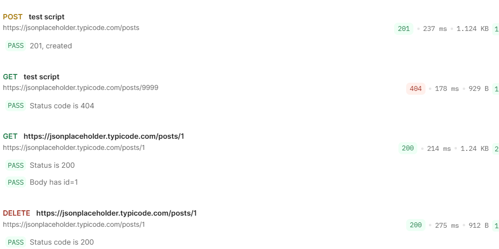

# Postman API Tests

A Postman collection testing a public practice API with GET, POST and DELETE requests.

## Requests and checks
| Request | Method | Checks |
|---|---|---|
| https://jsonplaceholder.typicode.com/posts/1 | GET | Status code is 200, body contains id field, response time under 975ms |
| https://jsonplaceholder.typicode.com/posts | POST | Status code is 201, body returns the new field id:101 |
| https://jsonplaceholder.typicode.com/posts/1 | DELETE | Status code is 200 |

## How to run
1. Import API practice.postman_collection/Practice.postman_collection.json into Postman
2. Click Run collection
3. All checks should pass

## Result

## What I checked and why
Status code confirms the server accepted the request, the body check confirms the right data came back, and the response-time check catches slow endpoints.
